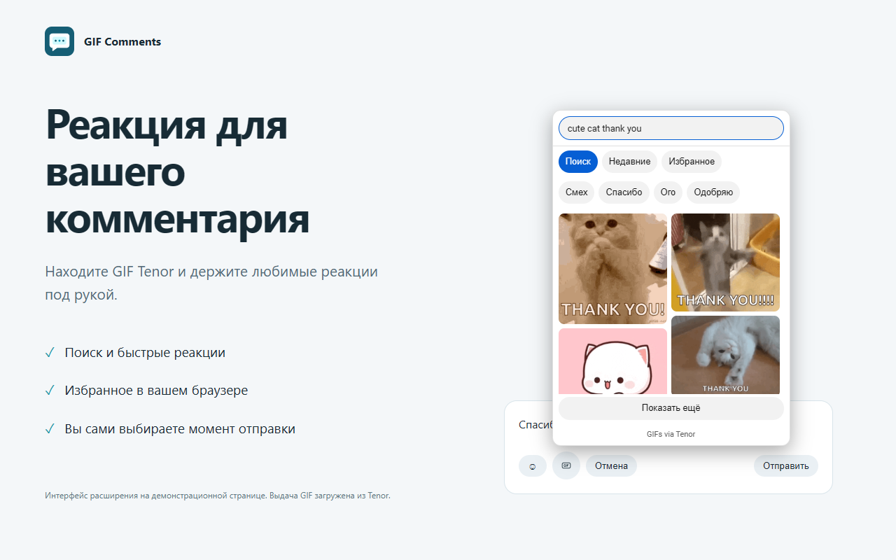

# GIF Comments

GIF-реакции Tenor в комментариях YouTube: поиск, избранное, недавние и резервные черновики. Для настольных Firefox, Chrome, Edge и Brave.

**[Скачать готовые архивы → Releases](https://github.com/IT-Shelter-Labs/gif-comments/releases/tag/v1.0.2)**

| Браузер | Файл |
|---|---|
| Firefox 140+ | [gif-comments-firefox-1.0.2.zip](https://github.com/IT-Shelter-Labs/gif-comments/releases/download/v1.0.2/gif-comments-firefox-1.0.2.zip) |
| Chrome / Edge / Brave | [gif-comments-chromium-1.0.2.zip](https://github.com/IT-Shelter-Labs/gif-comments/releases/download/v1.0.2/gif-comments-chromium-1.0.2.zip) |

Ранний выпуск с ручной установкой. Установка из каталога пока не подтверждена. Доступность отправки GIF зависит от YouTube, аккаунта и видео; реальная отправка через аккаунт ещё не проверена. Если результат неизвестен, проверьте комментарии перед повтором.

## Возможности

- Поиск Tenor, быстрые реакции и продолжение выдачи.
- До 300 избранных и 30 недавно отправленных GIF в браузере.
- GIF вместе с текстом или отдельно; замена и удаление до отправки.
- Экспорт и импорт избранного.
- Сворачивание распознанных GIF в комментариях.
- Резервные черновики до 24 часов и понятные сообщения об ошибках.
- Русский/английский интерфейс, светлая/тёмная тема и горячие клавиши.

На снимке — установленное расширение с выдачей Tenor на обозначенной демонстрационной странице.

## Firefox

1. Скачайте **Firefox ZIP** из Releases, не распаковывайте.
2. Откройте about:debugging#/runtime/this-firefox.
3. Нажмите «Загрузить временное дополнение» и выберите ZIP.
4. Разрешите доступ к заявленным сайтам, если браузер спросит; обновите YouTube.

После закрытия Firefox временное дополнение удаляется — загрузите ZIP повторно. Для постоянной установки нужна подписанная версия. Проверку подписей браузера отключать не требуется.

## Chrome / Edge / Brave

1. Скачайте **Chromium ZIP** и распакуйте в постоянную папку.
2. Откройте chrome://extensions, edge://extensions или brave://extensions.
3. Включите «Режим разработчика» → «Загрузить распакованное расширение».
4. Выберите папку с manifest.json и обновите вкладки YouTube.

Не перемещайте папку после установки. Две версии расширения одновременно использовать не следует.

## Использование

Откройте комментарий или ответ → GIF → выберите реакцию → допишите текст → нажмите кнопку отправки YouTube. Выбор картинки сам ничего не публикует.

Ctrl/Cmd+Enter отправляет, Esc закрывает выбор. Настройки, экспорт и резервные черновики доступны через значок расширения.

Поддерживается одна GIF Tenor в новом комментарии/ответе. Локальные картинки, стикеры, посты канала и редактирование существующего GIF-комментария не включены.

## Исходники и модификации

Исходный код в [extension](extension). Можно сделать Fork, изменить файлы и собрать свою версию. Нет обязательной сборки и runtime-зависимостей.

- Firefox: временно загрузите extension/manifest.json.
- Chromium: готовая папка получается командой python tools/package.py; результат в dist/chromium, архивы — в dist.
- Проверки без браузера: node tests/core.test.cjs (Node.js 22+).

Подробности: [CONTRIBUTING.md](CONTRIBUTING.md) и [архитектура](docs/ARCHITECTURE.md).

Для независимого форка смените ID Firefox. При распространении сохраняйте LICENSE/NOTICE и обозначайте изменения; не выдавайте изменённую сборку за исходный релиз.

## Данные и поддержка

Избранное, история и черновики хранятся локально. Tenor получает поисковые запросы и обращения за GIF; YouTube получает комментарий при отправке. Нет сервера разработчика, аналитики и рекламы. [Политика конфиденциальности](extension/PRIVACY.md).

Ошибки: [Issues](https://github.com/IT-Shelter-Labs/gif-comments/issues) или melroncode@bk.ru. Укажите версию браузера и расширения и текст ошибки. Не присылайте пароли, cookies, заголовки авторизации или личные черновики.

Сайт с политикой для заявки: https://it-shelter-labs.github.io/gif-comments-site/privacy.html. Репозиторий — основная страница проекта и скачивания.

## Проверка и лицензия

30 автоматических проверок и установочная проверка Edge пройдены; поиск Tenor проверен вживую, публикация YouTube имитировалась. В Firefox проверена временная установка. Местный валидатор Mozilla не выдал ошибок/предупреждений. Это не одобрение каталога и не подтверждение отправки для каждого аккаунта.

GPL-3.0, исходные уведомления сохранены в [NOTICE](NOTICE). GIF Comments — самостоятельное расширение, не связанное с YouTube, Google или Tenor.

## English

Search Tenor GIFs, keep favorites and attach a chosen GIF to your YouTube comment. Download browser-specific ZIP files from Releases. Firefox ZIP is installed temporarily through about:debugging; Chromium ZIP is unzipped and loaded with Developer mode. Readable source lives in extension; forks and contributions are welcome under GPL-3.0. GIF posting depends on YouTube availability and real-account posting remains unverified.
